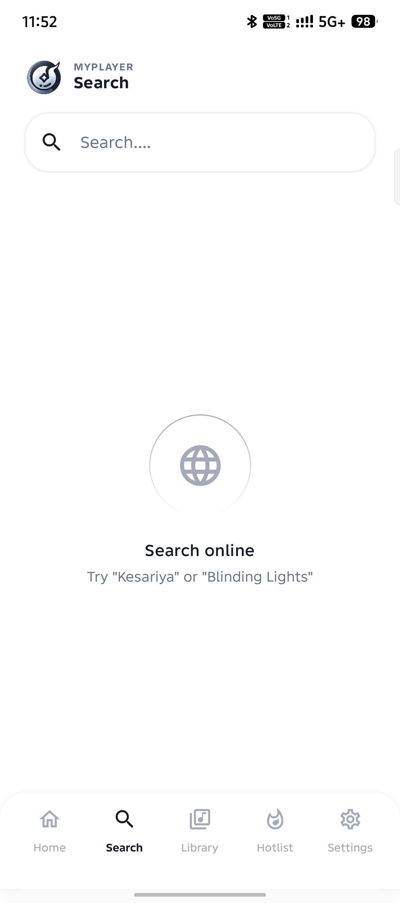

# 🎵 MyPlayer

<div align="center">


<p align="center">
  <b>A modern, ultra-high-performance Android music player delivering locked 120 FPS fluid UI, seamless local and YouTube Music streaming, intelligent recommendations, real-time synchronized lyrics, innovative dual-earbud playback, multi-device synchronized Sync Play, and a signature Dark Olive & Electric Neon Lime design system.</b>
</p>

</div>

---

## 🌟 Highlights & Key Features

- **⚡ Locked 120 FPS Performance & Butter-Smooth UI (v4.0)**: Engineered with Compose Compiler Strong Skipping Mode, AndroidX Baseline Profile AOT compilation, isolated recomposition trees, and hardware-accelerated GPU shaders for zero frame drops.
- **🛡️ Production-Hardened Release Engine (v4.0)**: Rock-solid YouTube Music streaming in Release APKs with full R8 rules preserving NewPipe & Mozilla Rhino JS engine deciphering, dynamic SSL/CA certificate validation, and zero logging overhead.
- **🖼️ Instant <1ms Artwork Fast-Path (v4.0)**: Instant thumbnail resolution for local files and YouTube streams, short-circuiting unnecessary external API calls to conserve battery and data.
- **🔁 Complete Queue, Shuffle & Repeat Engine (v4.0)**: End-to-end queue synchronization with ExoPlayer multi-item seek, randomized shuffle history, Repeat One, Repeat All, and continuous autoplay.
- **📶 Sync Play (Multi-Device Synchronized Playback)**: Play music in perfect sync across multiple phones/tablets over local Wi-Fi with auto-discovery (NSD) and direct IP join.
- **🎨 Modern Dark Olive & Electric Neon Lime Aesthetic**: An immersive dark theme featuring deep olive-charcoal backgrounds (`#12160E`), sleek surfaces (`#1A2216`), and vibrant electric neon lime accents (`#D2F83A`).
- **🌀 Signature Radial Audio Controller**: Interactive 270° circular seek arc supporting smooth touch and drag scrubbing, surrounded by concentric glowing aura sound rings and an apex favorite heart button.
- **🎧 Dual Bud Mode**: Play two separate, independent audio streams simultaneously—one in your left earbud and another in your right earbud with individual volume controls!
- **🌐 Hybrid Playback Pipeline**: Seamlessly switch between local device storage and online YouTube Music streaming through a unified Media3 / ExoPlayer core.
- **📜 Synced Lyrics**: Real-time synchronized lyrics powered by LRCLIB with silky-smooth auto-scrolling and manual line scrubbing.
- **🧠 Smart Recommendations & Autoplay**: Dynamic next-song recommendation engine that surfaces contextual tracks based on current playback genres, artists, and playback history.
- **💾 Offline Downloads & Backup**: Download online audio directly to local storage for offline playback, and export/import full library and playlist states using JSON backup & restore.
- **🛡️ Docked Floating Navigation**: Mini player and floating pill navigation bar docked within Scaffold's bottomBar, eliminating z-index overlapping and preventing obscured content.

---

## 📸 Screenshots

<div align="center">
  <h3>✨ Design Overview & Hero Radial Controller</h3>
  <b>Home Screen</b><br/>
  
</div>

<br/>

<div align="center">
  <h3>📱 App Screens</h3>
  <table align="center">
    <tr>
      <td align="center" width="16%">
        <b>Settings & Profile</b><br/>
        
      </td>
      <td align="center" width="16%">
        <b>Downloads</b><br/>
        
      </td>
      <td align="center" width="16%">
        <b>Playlist</b><br/>
        
      </td>
      <td align="center" width="16%">
        <b>Library</b><br/>
        
      </td>
      <td align="center" width="16%">
        <b>Online Search</b><br/>
        
      </td>
      <td align="center" width="16%">
        <b>Hotlist</b><br/>
        
      </td>
    </tr>
  </table>
</div>

---

## 🆕 What's New in Version 4.0

### 🚀 1. 120 FPS Locked Performance & UI Optimization
- **Compose Strong Skipping Mode**: Enabled `enableStrongSkippingMode = true` and stability configuration files in Compose Compiler, eliminating redundant recomposition cycles across entire screen hierarchies.
- **Baseline Profile Ahead-Of-Time (AOT) Compilation**: Integrated `androidx.profileinstaller:1.4.1` for runtime ahead-of-time DEX optimization, significantly reducing cold/warm app startup times and frame jank.
- **Recomposition Decoupling**: Refactored playback progress polling so high-frequency position ticks (every 500ms) only re-render the progress slider rather than triggering full-screen recompositions.
- **Hardware-Accelerated Modifiers**: Re-engineered `claySurface` and `clayConcave` with `drawWithCache` and `graphicsLayer` transforms, completely eliminating heavy CPU `BlurMaskFilter` and `PathOperation.Difference` allocations during fast scrolling.
- **Smart Image Downsampling**: Upgraded `AlbumArtImage` with exact pixel target sizing (`targetPx`), hardware bitmap allocations (`allowHardware(true)`), auto-downscaled YouTube thumbnails (`w226-h226` for list icons), and disabled list crossfade animations for silky-smooth 120 FPS scrolling.

### 🛡️ 2. Production Release Hardening & Online Streaming Stability
- **ProGuard / R8 Rules for NewPipe & Rhino**: Added comprehensive keep rules for `org.mozilla.javascript.**` (Mozilla Rhino JS Engine), `org.schabi.newpipe.**`, `nanojson`, and `jsoup`. Completely removed `-overloadaggressively` to prevent R8 from stripping reflection and script engine bytecode required for YouTube signature deobfuscation (`signatureCipher` & `n-parameter`).
- **Dynamic SSL & CA Validation**: Modernized `NetworkSecurityManager` to leverage Android's native system CA trust store and `network_security_config.xml`, safely resolving `SSLPeerUnverifiedException` caused by Google dynamically rotating regional CDN root/intermediate certificates.
- **Optimized OkHttpClient Stack**: Stripped `HttpLoggingInterceptor` from release builds for security and zero CPU overhead; configured an optimized connection pool (`ConnectionPool(10, 5, TimeUnit.MINUTES)`), 20s read timeout, and automatic connection retries (`retryOnConnectionFailure = true`).

### ⚡ 3. Instant Artwork Fast-Path
- **Zero-Latency Art Loading**: Short-circuited `ArtworkRepository.getArtwork()` to immediately return pre-existing local URIs or YouTube thumbnails (<1ms), bypassing 3 redundant external HTTP API calls (Deezer, iTunes, YouTube Music) per song.

### 🔁 4. Full Queue Routing, Shuffle & Repeat
- **Complete Queue Dispatch**: Updated `playOnlineQueueIndex` to send the complete playlist queue to `PlaybackRouter` instead of single-item requests, maintaining intact playback queues across sources.
- **Robust Playback State Handling**: Full state machine support for Repeat One (immediate song replay), Repeat All (smooth loop to start), ExoPlayer internal queue seek, randomized shuffle with history stack, sequential advancement, and automatic recommendation triggers upon queue completion.

---

## 🆕 What's New in Version 3.3

1. **Sync Play (Multi-Device Synchronized Music Playback)**:
   - Synchronized playback across 2 devices on the same local Wi-Fi.
   - Host (Master) room creation with local IP / port broadcast and NSD discovery.
   - Direct Join by IP address with automatic port scanning and fallback.
   - Track matching supporting both local library files and online YouTube Music streaming.
2. **Enhanced Connection Diagnostics & Resilient Socket Transport**:
   - Continuous accept loop on host side with automatic stream recovery upon client reconnect.
   - Live visual status indicators (broadcasting, connecting spinner, connected green badge).
   - Clear failure diagnostics and tips when running inside emulators or across subnets.

---

## 🆕 What's New in Version 3.2

1. **Brand-New Stitch UI**:
   - Complete redesign inspired by the modern aesthetic specification.
   - Deep organic olive-black palette with electric neon lime interactive accents.
2. **Radial Seek & Audio Controller**:
   - Circular seek arc replacing standard linear seekbars on the Now Playing screen.
   - Pulsing concentric sound waves responding to active playback.
3. **Personalized User Profile**:
   - Display name customization in both Settings and Home Screen.
   - Persistent preferences storage using AndroidX DataStore.
4. **Docked Navigation & Floating Pill**:
   - Fixed navigation bar and mini player z-index positioning inside `Scaffold`'s `bottomBar`.
   - Floating pill navigation bar with active neon lime circle indicator.
5. **Streamlined Library**:
   - Consolidated into clean "All Songs" and "Playlists" tabs.
6. **High-Fidelity Audio Stream Badges**:
   - Lossless and Hi-Res fidelity pill indicators showing bit depth, sample rate, and codec format.
7. **Automatic GitHub Releases Updater**:
   - Automated background updates check every 6 hours via WorkManager.
   - On-launch update verification and native notification dispatch linking to GitHub Release APKs.
   - On-demand "Check for Updates" option in Settings with interactive dialogs.

---

## 🏗️ Architecture & Technology Stack

MyPlayer is engineered following **Clean Architecture** principles and the **MVVM** pattern with strict Unidirectional Data Flow (UDF).

| Layer | Technologies / Libraries |
| :--- | :--- |
| **Language** | [Kotlin](https://kotlinlang.org/) (Coroutines, StateFlow, Flow) |
| **UI Toolkit** | [Jetpack Compose](https://developer.android.com/jetpack/compose) with Material 3, Custom Design Tokens & Strong Skipping Mode |
| **Runtime Optimization** | [AndroidX ProfileInstaller](https://developer.android.com/topic/performance/baselineprofiles/overview) (Baseline Profiles AOT) |
| **Audio Core** | [AndroidX Media3](https://developer.android.com/guide/topics/media/media3) (`ExoPlayer`, `MediaSession`, `MediaController`) |
| **Dependency Injection** | [Hilt](https://developer.android.com/training/dependency-injection/hilt-android) / Dagger |
| **Local Persistence** | [Room Database](https://developer.android.com/training/data-storage/room) & Jetpack DataStore |
| **Networking** | [OkHttp3](https://square.github.io/okhttp/) & [Retrofit](https://square.github.io/retrofit/) |
| **Streaming Extraction** | [NewPipeExtractor](https://github.com/TeamNewPipe/NewPipeExtractor) & [Mozilla Rhino](https://github.com/mozilla/rhino) |
| **Image Loading** | [Coil](https://coil-kt.github.io/coil/) (Hardware Bitmaps, Memory & Disk Caching) |
| **Paging** | AndroidX Paging 3 |

---

## 📁 Repository Structure

```text
MyPlayer/
├── app/
│   ├── src/
│   │   ├── main/
│   │   │   ├── java/com/example/myplayer/
│   │   │   │   ├── data/            # Room entities, DAOs, Repositories, Artwork & Lyrics APIs
│   │   │   │   ├── di/              # Hilt Dependency Injection modules
│   │   │   │   ├── dualbud/         # Dual-channel audio routing & earbud mixer
│   │   │   │   ├── playback/        # Media3 MusicController, Service & Source Resolvers
│   │   │   │   ├── security/        # Integrity and runtime security verification
│   │   │   │   ├── sync/            # Multi-device Wi-Fi synchronized playback (Sync Play)
│   │   │   │   ├── ui/              # Compose screens, components, theme & navigation
│   │   │   │   └── util/            # Helpers and background art fetchers
│   │   │   └── res/                 # Vector drawables, mipmaps, XML security configs
│   │   └── test/                    # Comprehensive unit tests (Artwork, Playback, Queue, etc.)
│   └── build.gradle.kts
├── docs/                            # Architectural design documents & screenshots
│   └── screenshots/                 # High-resolution screenshots and UI design specs
├── gradle/                          # Gradle wrapper and version catalog (libs.versions.toml)
├── CONTRIBUTING.md                  # Open source contribution guidelines
├── LICENSE                          # MIT Open Source License
└── README.md
```

---

## 🚀 Getting Started

### Prerequisites

- **Android Studio Koala (2024.1.1)** or Ladybug (2024.2.1+)
- **JDK 17** or **JDK 21** (or Android Studio Embedded JBR)
- Android SDK with:
  - `compileSdk`: **35**
  - `minSdk`: **28** (Android 9.0 Pie)
  - `targetSdk`: **36**

### Clone & Build

1. Clone the repository:
   ```bash
   git clone https://github.com/Aashutosh2021/MyPlayer.git
   cd MyPlayer
   ```

2. Open the project in Android Studio, or build via the command line:
   ```bash
   ./gradlew assembleDebug
   ```

3. Build the production release APK with full R8 optimization:
   ```bash
   ./gradlew assembleRelease
   ```

4. Run the unit test suite:
   ```bash
   ./gradlew testDebugUnitTest
   ```

---

## 🤝 Contributing

Contributions are warmly welcome! Whether it's reporting a bug, improving documentation, or proposing new features:

1. Check open issues or create a new discussion.
2. Fork the repository and create a feature branch (`git checkout -b feature/amazing-feature`).
3. Commit your changes and ensure all tests pass (`./gradlew testDebugUnitTest`).
4. Submit a Pull Request targeting `main`.

Please review our [Contribution Guide](CONTRIBUTING.md) for details on code style and architecture practices.

---

## 📄 License

This project is open-sourced under the [MIT License](LICENSE).
