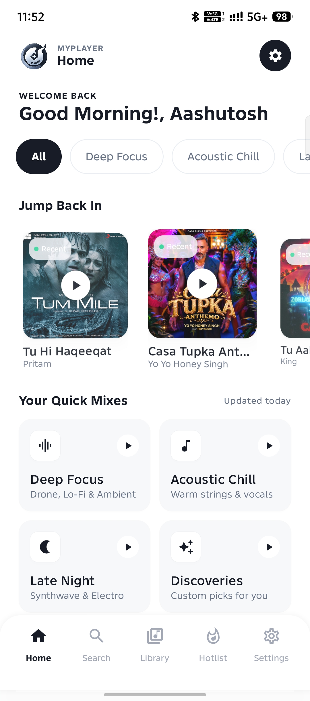
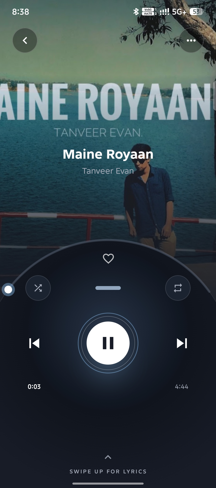
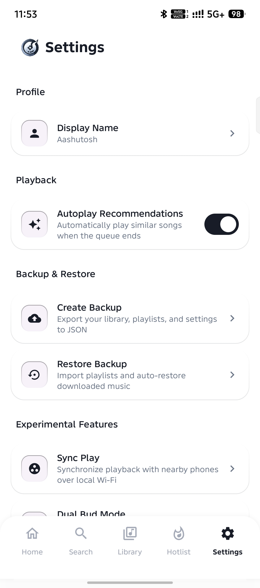
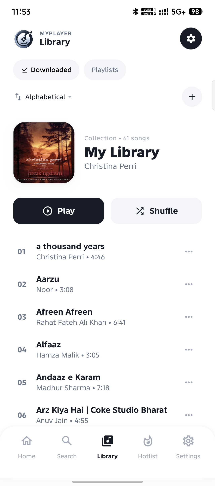
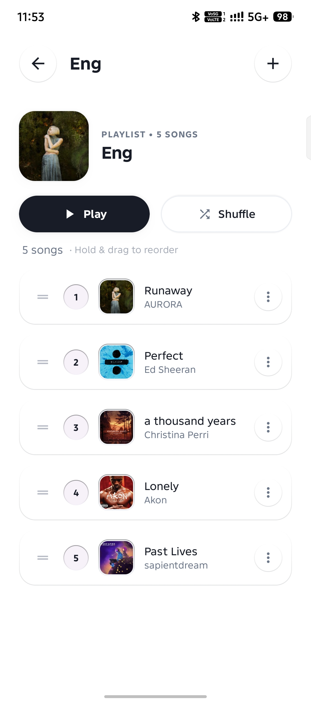
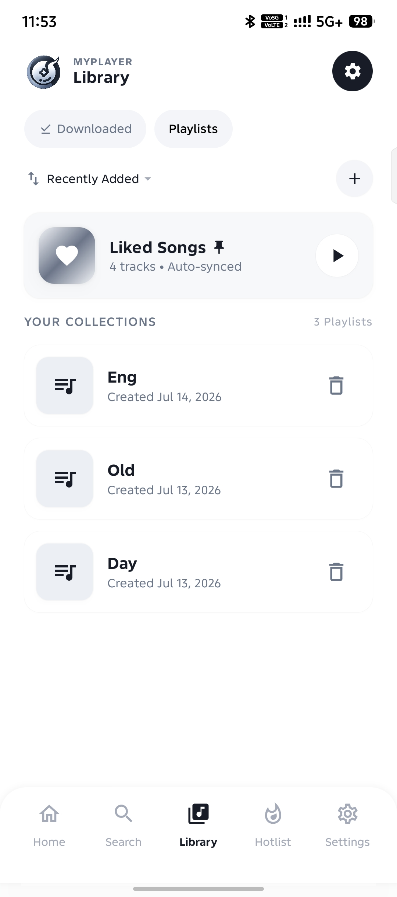
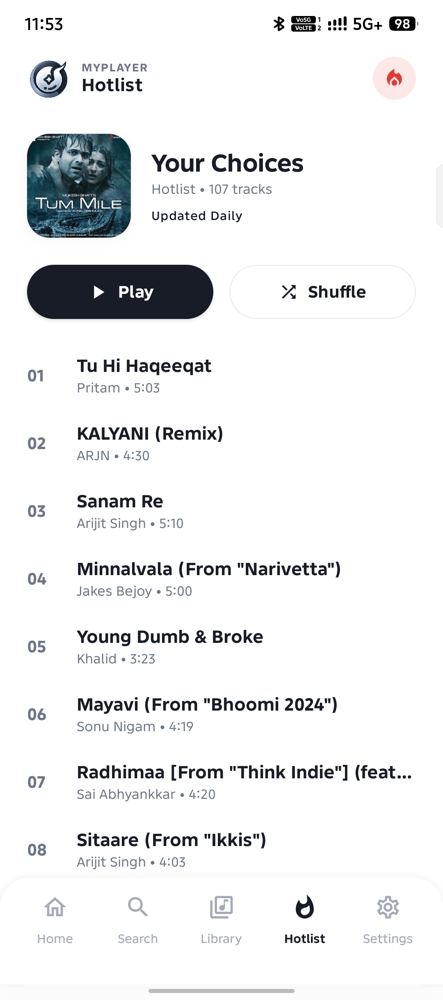

# 🎵 MyPlayer

<div align="center">


<p align="center">
  <b>A modern, ultra-high-performance Android music player delivering locked 120 FPS fluid UI, seamless local and YouTube Music streaming, intelligent recommendations, real-time synchronized lyrics, innovative dual-earbud playback, multi-device synchronized Sync Play, and a signature Dark Olive & Electric Neon Lime design system.</b>
</p>

</div>

---

## 🌟 Highlights & Key Features

- **⚡ Locked 120 FPS Performance & Butter-Smooth UI (v4.0)**: Engineered with Compose Compiler Strong Skipping Mode, AndroidX Baseline Profile AOT compilation, isolated recomposition trees, and hardware-accelerated GPU shaders for zero frame drops.
- **🛡️ Production-Hardened Release Engine (v4.0)**: Rock-solid YouTube Music streaming in Release APKs with full R8 rules preserving NewPipe & Mozilla Rhino JS engine deciphering, dynamic SSL/CA certificate validation, and zero logging overhead.
- **🖼️ Instant <1ms Artwork Fast-Path (v4.0)**: Instant thumbnail resolution for local files and YouTube streams, short-circuiting unnecessary external API calls to conserve battery and data.
- **🔁 Complete Queue, Shuffle & Repeat Engine (v4.0)**: End-to-end queue synchronization with ExoPlayer multi-item seek, randomized shuffle history, Repeat One, Repeat All, and continuous autoplay.
- **📶 Sync Play (Multi-Device Synchronized Playback)**: Play music in perfect sync across multiple phones/tablets over local Wi-Fi with auto-discovery (NSD) and direct IP join.
- **🎨 Modern Dark Olive & Electric Neon Lime Aesthetic**: An immersive dark theme featuring deep olive-charcoal backgrounds (`#12160E`), sleek surfaces (`#1A2216`), and vibrant electric neon lime accents (`#D2F83A`).
- **🌀 Signature Radial Audio Controller**: Interactive 270° circular seek arc supporting smooth touch and drag scrubbing, surrounded by concentric glowing aura sound rings and an apex favorite heart button.
- **🎧 Dual Bud Mode**: Play two separate, independent audio streams simultaneously—one in your left earbud and another in your right earbud with individual volume controls!
- **🌐 Hybrid Playback Pipeline**: Seamlessly switch between local device storage and online YouTube Music streaming through a unified Media3 / ExoPlayer core.
- **📜 Synced Lyrics**: Real-time synchronized lyrics powered by LRCLIB with silky-smooth auto-scrolling and manual line scrubbing.
- **🧠 Smart Recommendations & Autoplay**: Dynamic next-song recommendation engine that surfaces contextual tracks based on current playback genres, artists, and playback history.
- **💾 Offline Downloads & Backup**: Download online audio directly to local storage for offline playback, and export/import full library and playlist states using JSON backup & restore.
- **🛡️ Docked Floating Navigation**: Mini player and floating pill navigation bar docked within Scaffold's bottomBar, eliminating z-index overlapping and preventing obscured content.

---

## 📸 Screenshots

<div align="center">
  <h3>✨ Design Overview</h3>
  <b>Home Screen</b><br/>
  
</div>
<div align="center">
  <h3>✨ Hero Radial Controller</h3>
  <b>NowPlaying Screen</b><br/>
  
</div>

<br/>

<div align="center">
  <h3>📱 App Screens</h3>
  <table align="center">
    <tr>
      <td align="center" width="16%">
        <b>Settings & Profile</b><br/>
        
      </td>
      <td align="center" width="16%">
        <b>Downloads</b><br/>
        
      </td>
      <td align="center" width="16%">
        <b>Playlist</b><br/>
        
      </td>
      <td align="center" width="16%">
        <b>Library</b><br/>
        
      </td>
      <td align="center" width="16%">
        <b>Hotlist</b><br/>
        
      </td>
    </tr>
  </table>
</div>


---

## 🏗️ Architecture & Technology Stack

MyPlayer is engineered following **Clean Architecture** principles and the **MVVM** pattern with strict Unidirectional Data Flow (UDF).

| Layer | Technologies / Libraries |
| :--- | :--- |
| **Language** | [Kotlin](https://kotlinlang.org/) (Coroutines, StateFlow, Flow) |
| **UI Toolkit** | [Jetpack Compose](https://developer.android.com/jetpack/compose) with Material 3, Custom Design Tokens & Strong Skipping Mode |
| **Runtime Optimization** | [AndroidX ProfileInstaller](https://developer.android.com/topic/performance/baselineprofiles/overview) (Baseline Profiles AOT) |
| **Audio Core** | [AndroidX Media3](https://developer.android.com/guide/topics/media/media3) (`ExoPlayer`, `MediaSession`, `MediaController`) |
| **Dependency Injection** | [Hilt](https://developer.android.com/training/dependency-injection/hilt-android) / Dagger |
| **Local Persistence** | [Room Database](https://developer.android.com/training/data-storage/room) & Jetpack DataStore |
| **Networking** | [OkHttp3](https://square.github.io/okhttp/) & [Retrofit](https://square.github.io/retrofit/) |
| **Streaming Extraction** | [NewPipeExtractor](https://github.com/TeamNewPipe/NewPipeExtractor) & [Mozilla Rhino](https://github.com/mozilla/rhino) |
| **Image Loading** | [Coil](https://coil-kt.github.io/coil/) (Hardware Bitmaps, Memory & Disk Caching) |
| **Paging** | AndroidX Paging 3 |

---

## 📁 Repository Structure

```text
MyPlayer/
├── app/
│   ├── src/
│   │   ├── main/
│   │   │   ├── java/com/example/myplayer/
│   │   │   │   ├── data/            # Room entities, DAOs, Repositories, Artwork & Lyrics APIs
│   │   │   │   ├── di/              # Hilt Dependency Injection modules
│   │   │   │   ├── dualbud/         # Dual-channel audio routing & earbud mixer
│   │   │   │   ├── playback/        # Media3 MusicController, Service & Source Resolvers
│   │   │   │   ├── security/        # Integrity and runtime security verification
│   │   │   │   ├── sync/            # Multi-device Wi-Fi synchronized playback (Sync Play)
│   │   │   │   ├── ui/              # Compose screens, components, theme & navigation
│   │   │   │   └── util/            # Helpers and background art fetchers
│   │   │   └── res/                 # Vector drawables, mipmaps, XML security configs
│   │   └── test/                    # Comprehensive unit tests (Artwork, Playback, Queue, etc.)
│   └── build.gradle.kts
├── docs/                            # Architectural design documents & screenshots
│   └── screenshots/                 # High-resolution screenshots and UI design specs
├── gradle/                          # Gradle wrapper and version catalog (libs.versions.toml)
├── CONTRIBUTING.md                  # Open source contribution guidelines
├── LICENSE                          # MIT Open Source License
└── README.md
```

---

## 🚀 Getting Started

### Prerequisites

- **Android Studio Koala (2024.1.1)** or Ladybug (2024.2.1+)
- **JDK 17** or **JDK 21** (or Android Studio Embedded JBR)
- Android SDK with:
  - `compileSdk`: **35**
  - `minSdk`: **28** (Android 9.0 Pie)
  - `targetSdk`: **36**

### Clone & Build

1. Clone the repository:
   ```bash
   git clone https://github.com/Aashutosh2021/MyPlayer.git
   cd MyPlayer
   ```

2. Open the project in Android Studio, or build via the command line:
   ```bash
   ./gradlew assembleDebug
   ```

3. Build the production release APK with full R8 optimization:
   ```bash
   ./gradlew assembleRelease
   ```

4. Run the unit test suite:
   ```bash
   ./gradlew testDebugUnitTest
   ```

---

## 🤝 Contributing

Contributions are warmly welcome! Whether it's reporting a bug, improving documentation, or proposing new features:

1. Check open issues or create a new discussion.
2. Fork the repository and create a feature branch (`git checkout -b feature/amazing-feature`).
3. Commit your changes and ensure all tests pass (`./gradlew testDebugUnitTest`).
4. Submit a Pull Request targeting `main`.

Please review our [Contribution Guide](CONTRIBUTING.md) for details on code style and architecture practices.

---

## 📄 License

This project is open-sourced under the [MIT License](LICENSE).
